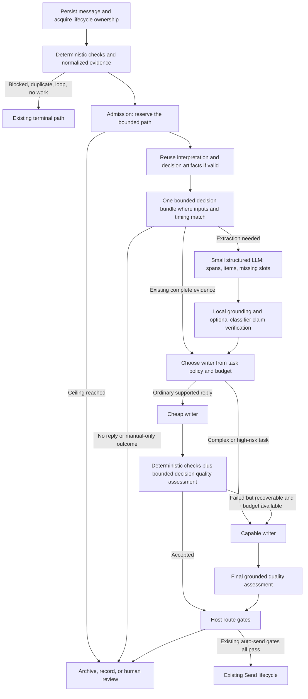

# Owlat AI routing and classifier migration

Status: proposed architecture, revision 9. Phase 0 (model-default refresh) is
implemented in this worktree but not committed.
Reviewed: 2026-10-11, by Opus and Codex `gpt-6.1-sol`. Every price and code claim
below was checked against the official pricing pages and the current tree.
Scope: Team Inbox, Postbox, assistant, and background AI.

The [open decisions](#open-decisions) at the end need the owner's answer before
Phase 1b starts. Each has a recommendation. The [routing ladder](#routing-ladder-a-model-only-when-it-is-needed)
defines when a message reaches a model at all.

## Recommendation

Spend follows the writers. With the refreshed defaults a fast-tier call costs
$0.10 per million input tokens (GPT-6 Luna, Haiku 5.5), ten times less than the
previous `gpt-5.6-luna` default. A classification bundle now costs about $0.0006
per message on Luna, while one capable draft costs about $0.026. Capable-tier
clarification sampling in Postbox and capable drafting are where the money goes.
Phases 3 and 4 hold most of the savings. Order them by measured spend share and
migration risk once the Phase 1a baseline exists.

Use the decision plane for bounded judgments because it gives typed answers,
abstention, and a probability that can be calibrated per task. Its input price
is lower too, but at these prices the saving per message is small, and it is
not the reason to migrate. Category and reply disposition are the low-risk first
place to prove the plane end to end.

Keep small generative models for grounded extraction, summaries, clarification
text, and routine drafts. Escalate to a capable writer only when the task, the
evidence, the quality checks, and the remaining budget justify it. Authorization,
delivery, numeric rules, and the final auto-send decision stay in host code.

Optimize cost per accepted outcome. A route is cheaper only if the complete path,
including retries, context preparation, and fallback, costs less at equal quality.
Local inference has hardware and queue costs. A token price of zero does not make
it the cheapest route everywhere.

## What exists today

Paths are relative to `apps/api/convex/`.

| Area | Current behavior and implication |
| --- | --- |
| Team Inbox | Steps run `security_scan` → `context_retrieval` → `classify` → `clarify` → `draft` → `route`. Each step's `route()` picks the next one; `agent/walker.ts` runs one step by kind. The prompt-injection guard is a layer inside `security_scan`. Quarantine, spam archive, and the informational exit are transitions, not steps. Interpretation runs inside `context_retrieval` (`currentMessage.ts`). Plugin steps can follow any core step. Preserve lifecycle ownership and the existing terminal exits. |
| Team Inbox classifier | `agent/steps/classify` on the fast tier returns enum-valued `category`, `priority`, `sentiment`, `intent`, and `kind`; numeric `[0,1]` `confidence` and `importance`; boolean `needsResponse`; and a `language` string sanitized before downstream use. Its categories differ from Postbox's (`mail/ai/categoryClassify.ts`). |
| Postbox | `mail/deliveryPipeline/afterInsert.ts` schedules needs-reply, category (heuristic inline, LLM only for ambiguous mail), interpretation, and knowledge extraction. `needsReply` calls `runInterpretation` itself and hosts the run, so there is no second extraction pass. Its clarification still makes its own calls. |
| Interpretation | `mail/interpret/run.ts` gates, extracts on the fast tier, grounds, verifies, and applies a reducer, with segment dedupe and stored projections. The verifier uses the fast tier, three claims per call, with no per-message cap. Schema maximums allow about 32 verifiable claims, roughly 11 calls for one attacker-written message. |
| Drafting | `runSharedDraft` (`agent/shared/draftService.ts`) serves Team Inbox, draft-on-arrival, and needs-reply drafts. The manual Postbox "Draft with AI" path (`mail/ai/composeDraftWrite.ts`) does not use it and keeps its own injection check. Keep `runSharedDraft` as the writer seam. |
| Complexity routing | `lib/llm/complexity.ts` can downgrade capable → fast behind `LLM_COMPLEXITY_ROUTING=1` (`lib/llmProvider.ts`). It is off by default and one-way. `TRIVIAL_INTENTS` lists intents the classifier never emits, so in practice only `acknowledgment` matches. |
| Decision providers | `lib/decision/*` and `lib/decisionProviders/*` provide TypeSafe, local GLiNER, and an LLM-backed adapter. The only production `runDecision` caller is the settings connection test. An explicitly configured provider with bad credentials silently resolves to the language-backed plane (`lib/decisionProvider.ts` `planeFor`), which bypasses the fallback opt-in and breaker. |
| Language dispatch | `lib/llm/dispatch.ts` centralizes text, structured output, tools, streams, retries, and usage normalization. `runLlmObject` takes no output-token limit. |
| Spend ledger and ceiling | `analytics/llmUsage.ts` (`llmUsageEvents`) is the single source of truth for priced spend (owner decision, 2026-10-06). Rows carry `requestId`, `plane`, `isFallback`, `isCalibrated`, but no root-request or parent-call id. `analytics/spendBudget.ts` enforces daily and monthly USD ceilings over a bounded scan of at most 12,000 events. It checks recorded spend and reserves nothing, so concurrent calls can overshoot. `mail/ai/gate.ts` and `mail/interpret/gate.ts` check before the call but allow it when the budget computation throws. The Team Inbox guard, classify, clarify, and draft calls only record spend; past the ceiling the agent keeps drafting and only auto-send is withheld. `voiceProfileActions.ts` calls models with no gate. |
| Plugin accounting | `plugins/llm.ts` reserves estimated cost × max attempts before each dispatch and refuses unpriced models; `plugins/llmAccounting.ts` enforces the manifest's daily budget and settles afterwards. This is the pattern to reuse for core admission. |
| Decision rate limits | `decision/gate.ts` charges once per logical call. The per-attempt `DecisionRateLimiter` port in `lib/decision/ports.ts` is unbuilt. The LLM decision adapter retries inside `runLlmObject`, so an outer per-attempt port alone would still miss up to three paid requests. |
| Clarification | Three related flows. Postbox (`mail/ai/needsReplyClassify.ts`) runs only when a reply is needed and the AI gate passes, then samples three candidate drafts and a divergence judge on the capable tier when stage 1 finds non-file slots. Team Inbox (`agent/steps/clarify`) runs the same stages on the fast tier and skips them when the eagerness dial is off, on an attachment ask, or on high context coverage. Answer mode (`mail/ai/composeDraftGap.ts`) samples on the fast tier, or capable when the dial is cautious. Postbox's capable sampling is an early savings target. |
| Evaluation | `mail/interpret/__eval__` has a fictional 13-slice corpus (including `de`, `injection`, `long_threads`, `out_of_order`), replay, grounding and cost metrics, and a CLI (`apps/api/scripts/interpret-eval.ts`). Without a model it replays the labels as an oracle, which proves nothing about model accuracy. No decision calibration report exists yet; ADR-0060 gates every decision cutover on one. |
| Embeddings | `knowledgeEntries` and `semanticFiles` stamp the constant `CURRENT_EMBEDDING_MODEL` (`text-embedding-3-small`) whatever model embedded them. Saving a different embedding model bumps `embeddingModelVersion`, but nothing reads it. Retrieval does not filter by model, and no re-embed runs on change. Switching embedding models today mixes vector spaces. |

[ADR-0060](../adr/0060-decision-plane.md) defines the decision contract and the
restrictions this plan keeps.

## Target call flow

Retrieval and embeddings stay independent services. The assistant uses the same
policy and accounting services and keeps its conversation tool loop. Plugin
strategies remain replaceable writers under host-owned checks and budgets.

## Task migration map

| Task | Preferred executor | Migration and fallback behavior |
| --- | --- | --- |
| Duplicate, malware, blocked sender, loop, retention, permissions | TypeScript / existing services | No model. These checks stay authoritative. |
| Category, intent, sentiment, priority, kind, language, importance, reply disposition | Decision bundle: `choice`, `score`, `noul` | Map enum fields to explicit Choice domains, reply disposition to a host-interpreted Noul/Choice contract, and language to a reviewed supported-code domain with an unknown outcome. Define separately how the consumers of today's numeric `confidence` change and how `importance` is represented; any mapping onto the persisted numeric `importance` is a versioned host lookup checked against its consumers, never a normalized Score or an answer probability. Write the per-surface mapping for every field before migrating, with an explicit unknown default and the host disposition rule for each value; Team Inbox and Postbox categories differ. Register each bundle in `lib/decision/catalog.ts`. Name which probability each threshold reads (Noul probability, Choice peakedness). Treat Score outputs as ordinal labels, never magnitudes. Batch compatible questions over the same bounded state. Abstain or keep human review on ambiguity. |
| Prompt-injection judgment | Local signatures plus decision question | Shadow before replacing the LLM guard. Keep window coverage, the deterministic OR rules, and `guardUnavailable` blocking auto-send. A classifier cannot certify that hostile text is safe. |
| Action items, facts, quotations, amounts, dates, missing-slot values | Small structured LLM plus deterministic parsing | Jev does not generate strings. Keep exact-span grounding, schema validation, arithmetic, and reducers. Local span extraction can be evaluated separately. |
| Claim supported by provided evidence | Decision `choice`: supported / contradicted / insufficient | Feed only bounded claim/evidence pairs. Exact quotation checks run first. Consequential or insufficient claims block automation. Add a per-message claim cap; today one message can trigger about 11 verifier calls. |
| Clarification necessity and whether answers materially differ | Decision question over extracted slots and evidence | Decide necessity before any sample reply. Generate samples only for cases the decision leaves unresolved. |
| Clarification questions and localization | Small LLM or reviewed templates | One shared generator after necessity is established. It produces every necessary question in one bounded batch, never a single question. No capable writer by default. |
| Draft complexity / writer choice | Deterministic policy plus decision labels | Extend `lib/llm/complexity.ts` and the existing `LLM_COMPLEXITY_ROUTING` resolver instead of adding a second router; fix `TRIVIAL_INTENTS` first. Sender text alone must not force a weak model. Use known task/risk/evidence features and an evaluation-backed eligible set. |
| Reply writing, assistant synthesis, campaign copy | Cheap or capable generative LLM | Cheap first for eligible tasks; direct capable for validated complex tasks. At most one quality escalation, charged to the same request reservation. |
| Coverage, contradictions, tone compliance, relevance | Code plus decision bundle | Keep the existing plan coverage and self-check sharing. Models assess semantics; code checks recipients, required slots, links, forbidden commitments, and DLP. |
| Knowledge extraction and summaries | Small LLM, then bounded decision filters | Skip duplicates and irrelevant material before extraction. Batch background work and embed changed entries only. |
| Retrieval candidate ranking | Vector/full-text first; optional classifier rerank | Shortlist in code. Rerank only when measured relevance gains pay for the extra calls. Never rescore the whole corpus. |
| Final auto-send and outbound Send | Host code | Keep permission floors, recipient/DLP checks, quality gates, autonomy policy, and the Send lifecycle. Model results can restrict eligibility. This migration cannot widen it. |

Category is not display-only today. A Postbox `spam` category moves the thread to
Spam (`mail/category.ts`), Team Inbox classification archives spam and ends
informational mail (`agent/steps/classify`), and Postbox interpretation waits for
category refinement in some cases (`mail/interpret/run.ts`). The first category
canary changes display projections only. Spam movement, archival, reply
suppression, and interpretation eligibility keep their current source until each
is evaluated separately. When bundling, keep the settlement order, so that
interpretation never waits on a decision that itself needs interpretation.

TypeSafe's published model is built for typed decisions and charges input only,
at $0.042 per million tokens; output is unmetered. That is a provider claim and
price, not evidence of accuracy on Owlat mail.
[TypeSafe introduction](https://typesafe.ai/blog/introducing-system-one-models-and-jev)

## Routing ladder: a model only when it is needed

Every inbound message climbs the same ladder and stops at the first rung that
settles it. A rung runs only if every cheaper rung abstained, and only for the
work the message still needs. Apply the ladder per task and per consumer.

Host code settles deterministic outcomes first. When the decision plane is
enabled (`ai.decisionPlane`, off by default) and a usable non-language provider
is configured, eligible bounded questions go there. Otherwise authorized
language triage is one admitted fast-tier bundle as its primary route; that is
not a provider-failure fallback. A deliberately selected `llm` decision adapter
is that same paid rung and must not be followed by a second fast triage call.
An explicitly selected but invalid non-language provider follows the terminal
failure rules in the routing policy.

| Rung | Executor | Settles | Cost |
| --- | --- | --- | --- |
| 0 | Host code | Malware, auth/DMARC, MTA spam verdict, blocklist, mailbox filters, handling rules that read only sender, domain, or subject, owner overrides, a valid stored artifact, the unified mail-kind detector, sender memory | none |
| 1 | Decision plane | Bounded triage questions the code could not settle, asked as one bundle | Jev input-only, or free when local |
| 2 | Fast LLM | Triage when no decision provider is configured (one bundled call, not one call per question), plus extraction and verification for messages that still need them | fast tier |
| 3 | Capable LLM | Drafts and the few judgments that evaluation shows need it | capable tier |

Five rules decide the order of work inside a pipeline:

1. **Gate before spend.** Every deterministic stop runs before the first paid
   call that its outcome would make pointless.
2. **Triage before extraction.** Settle whether a message needs any work before
   paying for interpretation, retrieval, or clarification on it.
3. **One call per compatible question set.** Bundle questions that share
   bounded evidence, timing, authorization, and failure semantics. Keep the
   category/interpretation settlement order, and reuse existing reply
   projections instead of adding a second extractor.
4. **Lazy for display-only work.** Work whose only consumer is a screen runs
   when someone opens that screen, unless the product decision says otherwise.
5. **Remember valid settled answers.** Reuse owner overrides and stored
   artifacts only while their evidence, scope, state, versions, and expiry stay
   valid. Sender identity alone never settles a new message.

### Where today's pipelines break the ladder

Measured against the code on 2026-10-11:

| Gap | Today | Change |
| --- | --- | --- |
| L1 | Team Inbox runs the LLM guard (up to 4 windows) before two stops that need no model: `spamScore >= 80` archives and `ai.agent` off ends the run (`security_scan/index.ts`: the score is computed at 294, the guard runs at 319, the stops follow). | Run the deterministic injection, smuggling, and URL-reputation checks before the model guard, and end a confirmed deterministic quarantine without a model call. Keep their quarantine precedence over spam archival and agent-disabled completion. Skipping the semantic guard for spam-scored or agent-disabled mail is a safety tradeoff for decision 13; if approved, persist that the guard did not run and require it before any later autonomous processing. |
| L2 | Three automated-mail detectors disagree. `isAutomatedMail` (Team ingest, Postbox knowledge) reads List-Id, Precedence, and Auto-Submitted. `isAutomatedByHeaders` (needs-reply) also reads List-Unsubscribe and unattended senders. The category heuristic ignores List-Id and Auto-Submitted. "Known sender" means any `mailContacts` row for category but `useCount > 0` for interpretation. | Share normalized header and sender evidence, with separate predicates for loop suppression, reply candidacy, category, interpretation eligibility, knowledge extraction, and attachments. Keep the intentional `X-Owlat-Forwarded` distinction (loop suppression on Team ingest; forwarded human mail can still need a reply), and keep address-book membership, screener acceptance, and prior correspondence distinct. Any changed consumer outcome needs evaluation and approval. |
| L3 | Postbox clarification (up to 3 capable samples and a capable judge) spends before `applyResult` applies the sender screener (`needsReplyClassify.ts`, `needsReply.ts`). The screener also runs on the heuristic baseline before interpretation, but that result does not stop the action. | Screen first and clarify only threads that survive it. |
| L4 | Team handling rules run after classify, so a rule that archives by sender still pays for classification. | Before retrieval and classification, evaluate enabled rules with no non-empty categories facet against the same sender, subject, and bounded body inputs used today, keeping AND-across-facets semantics. A matching `auto_archive` may end the run after the safety checks. Other restrictive actions carry forward; a categorize action does not replace classification or its complaint/spam/urgent protections. Category-dependent rules stay after classification. |
| L5 | No MTA spam verdict reaches the Team Inbox path. | Pass the MTA spam verdict through ingest (`inbox/receiveInbound.ts` takes no verdict today) with trusted provenance. Before making it terminal at rung 0, get explicit approval and compare the resulting archives and quarantines with the current Team path under Phase 1c's acceptance gate. Quarantine keeps precedence, and any semantic-guard skip follows decision 13. |
| L6 | Attachments are summarized, embedded, and extracted for mail in Spam and for automated mail (hosted MX). | Apply folder, verdict, and mail-kind gates. This changes what appears in the file library and retrieval, so it needs approval and a visible record of skipped files. |
| L7 | Knowledge extraction runs on List-Unsubscribe newsletters and embeds every extracted entry with no cap. Live Postbox delivery excludes Spam/Trash/Sent/Drafts but does not recheck the folder when the scheduled extraction runs. Team Inbox and file extraction ignore `ai.knowledge` ([#1335](https://github.com/wolvesdotink/owlat/issues/1335)). | Enforce `ai.knowledge` where extraction runs, use the shared evidence, recheck the folder, and cap entries per message with approval, since a cap truncates stored knowledge. |
| L8 | Team retrieval embeds the same query twice, once for knowledge and once for files. | Embed once and share the vector, keeping the query text for both full-text legs. |
| L9 | Only the draft prompt carries a cache marker, and only Anthropic reads it. Every fast-tier call sends one `prompt` string. | Separate stable instructions from message content where useful and evaluate caching per task, model, and transport. Measure the eligible prefix, observed reads and writes, reuse within the TTL, and billed cost. Use cache controls only where the prefix meets the provider minimum (512 tokens on Haiku 5.5, 1,024 on GPT-5.6 and later) and the savings cover write charges. Don't pad prompts, and don't assume the Anthropic marker enables caching through OpenRouter. |
| L10 | Apart from owner-authored sender category overrides in Postbox, no classification is reused across messages. A sender's hundredth identical notification is classified like the first. | Sender memory (decision 12). |
| L11 | Team interpretation (1 extract and up to 7 verify calls) and two retrieval embeddings run before classify, so spam and informational verdicts cannot save them. Classify reads the full retrieval context, so this is not a free reorder. | A message-only triage bundle before retrieval and interpretation, evaluated against today's classifier (decision 11). |
| L12 | Postbox interprets mail that the needs-reply screen already ruled out (notifications, receipts, a known sender's newsletters, Auto-Submitted mail) because the thread brief shows its facts. | Defer only where the reader display is the sole remaining consumer (decision 10). |
| L13 | The LLM guard runs on every Team message, including spam-scored mail that is archived and mail that arrives while the agent is off, where no model consumes the content afterwards. | Skip the model guard only when no guarded consumer remains; otherwise keep it before the first generative consumer, which includes interpretation and knowledge extraction (decision 13). |
| L14 | No batch API is used. Knowledge extraction, attachment summaries, and backfill all run as real-time requests. | Send non-interactive work through provider batch APIs where the adapter supports them (Phase 5). |

Gaps that only avoid or merge existing calls (L1's deterministic-quarantine
part, L3, L8, and the dedupe, empty-corpus, and no-pair skips below) keep their
settled consumer outcomes. L2, L4, L5, L6, L7, and L9 can change stored
knowledge, the file library, or routing, so each needs an outcome-specific
evaluation. Making the newly passed MTA verdict terminal (L5) also needs
explicit approval under Phase 1c. Skipping the semantic guard (L1, L13) changes
quarantine coverage: those messages lose the semantic-injection verdict and the
quarantine workflow unless a deterministic check catches the threat. L10 to L13
need the owner's decision. The Phase 1a baseline measures all of them.

Calls the gap table does not name, also in Phase 1c:

- The guard runs even after the deterministic layers have already settled a
  quarantine (`security_scan/index.ts`: regex at 281–291, guard at 319, URL
  reputation only after it).
- Outcome sentiment (`agent/outcomeFeedback.ts`) is scheduled before the
  blocklist and automated-mail checks. It already skips mail that was not
  auto-sent, but it has no admission gate and no decision-plane route. It has
  its own consumer policy and must not inherit reply-generation suppression.
- Knowledge extraction embeds each entry before the dedupe check, then
  discards the vector when the entry already exists (#1335).
- Retrieval embeds the query even when no eligible vectors exist.
- Relation inference calls the model when no unlinked pair is left to write
  (#1335).

Within the decision plane the ladder could go one rung further: a free local
engine first and a hosted provider only when it abstains. Today the plane
resolves one provider. A local-then-hosted cascade waits until the local
engine's agreement report exists, since it is always uncalibrated.

## Price-sensitive routing policy

Add a small task-policy catalog in `lib/llm/`, read by the existing resolver and
dispatch. Each entry defines its plane, allowed models, maximum input and output
(including reasoning), deadline, retry allowance, eligible fallback, and
evaluation version. Use explicit task names such as `mail.classify`,
`mail.extract`, `mail.clarify`, `mail.draft`, `mail.verify`, and
`assistant.answer` instead of relying only on today's fast/capable split. The
catalog is task routing. `lib/llm/requestPolicy.ts` is SDK wire compatibility
and owns capability workarounds only; renaming it to `sdkCompat.ts` would make
that plain.

For each request:

1. Enforce organization settings, provider consent, local-only requirements, and
   capability constraints before price. Route only among configured and
   authorized providers. A cheaper provider elsewhere is not eligible because it
   is cheaper.
2. Return a valid stored artifact or deterministic result when one exists.
3. Prefer the configured decision provider for bounded questions. The LLM-backed
   adapter remains a compatibility route and does not inherit TypeSafe
   calibration.
4. For generative tasks, choose the cheapest eligible model that passed the
   task's quality and latency evaluation. Estimate full-request cost from bounded
   input, output and reasoning tokens, expected retries, tool rounds, and
   context-dependent rates.
5. Reserve the complete allowed path before dispatch. A cheap first pass plus a
   capable retry must fit the remaining budget. If it does not, queue background
   work, drop optional context, or hand to human review. Never bypass a guard.
6. Allow one quality escalation and bounded transport retries. Exactly one layer
   owns retries for each provider request, so SDK retries, decision fallback, and
   writer retries cannot multiply.
7. Record the route reason, policy version, actual provider identity, attempts,
   fallback, quality result, latency, and all reported billed usage.

Decision fallback stays opt-in and breaker-protected. Missing, malformed,
rejected, or undecryptable credentials, invalid provider configuration, consent
denial, codec refusal, and exhausted caps are terminal. They never trigger
another paid provider, even when fallback is enabled; the caller keeps its
deterministic baseline or goes to human review. Eligible operational failures
(timeouts, 5xx, throttling) may make at most one explicit fallback hop through
the breaker and admission. Resolver degradation must keep the original failure
and must not relabel an explicitly selected provider as an `llm` primary. Only a
deliberately configured `llm` kind uses the language plane as its primary.

An uncalibrated or changed model may still produce labels, but its probability
must never serve as a positive threshold for auto-send. The adapter's
`calibrated: true` means only that TypeSafe served the pinned Jev model. It does
not mean the model is calibrated on an Owlat question, language, or bundle.
Calibrate each task and language on representative held-out data; a peaked
distribution is not proof of correctness.

Azure model IDs are operator-chosen deployment names. A GPT-6 deployment named
`mail-fast` gets none of the GPT-6 compatibility handling or pricing today,
because both match on the model ID. Store canonical model identity or
capability metadata for Azure deployments before the policy applies
compatibility or price rules to them.

## Current model defaults

Phase 0 centralizes language defaults and picker options in
`packages/shared/src/aiModelCatalog.ts`. Backend adapters, web settings, and
setup suggestions read it. Stored IDs and explicit environment overrides remain
operator choices and are never silently overwritten.

| Provider | Fast / extraction | Capable / writing | Notes |
| --- | --- | --- | --- |
| OpenAI | `gpt-6-luna` | `gpt-6.1-sol` | Native Responses API; low reasoning default and no unsupported sampling. |
| Anthropic | `claude-haiku-5-5` | `claude-sonnet-5-5` | Opus/Fable remain optional; routine writing defaults to Sonnet. Sonnet 5.5 rejects non-default sampling values. |
| Google | `gemini-3.5-flash-lite` | `gemini-3.8-flash` | Stable models for these roles, not preview defaults. |
| Azure | `gpt-6-luna` | `gpt-6.1-sol` | Suggested deployment names only. The operator provisions regional deployments; see the Azure identity note above. |
| OpenRouter | `openai/gpt-6-luna` | `anthropic/claude-sonnet-5.5` | Exact aggregator IDs, two vendors. Luna reasoning is disabled on this wire for tool compatibility. Mixed vendors need owner sign-off (decision 7). |
| Local compatible | `qwen3.6:27b` | `qwen3.6:27b` | The smaller current Qwen variant; weights alone are 18–19 GB. Choose an installed smaller model on constrained hardware. |

Sources: [OpenAI models](https://developers.openai.com/api/docs/models),
[Claude models](https://platform.claude.com/docs/en/models/overview),
[Gemini models](https://ai.google.dev/gemini-api/docs/models),
[Azure availability](https://learn.microsoft.com/en-us/azure/foundry/foundry-models/concepts/models-sold-directly-by-azure),
[OpenRouter catalog](https://openrouter.ai/api/v1/models),
[Ollama Qwen](https://ollama.com/library/qwen3.6).

Google's embedding default is now `gemini-embedding-2`, requesting 768
dimensions and one embedding per text, which avoids the SDK's legacy batch
endpoint. The vector index is 1536 wide and narrower vectors are zero-padded, so
a mixed space never errors; retrieval just gets quietly worse. Existing Google rows that omitted the
model resolve to the legacy `text-embedding-004`, and the settings form
resubmits that value, so their vector space does not change. New Google saves
store the selected model and bump `embeddingModelVersion`. That bump does not
trigger a re-embed or exclude old vectors today. Any embedding change on a
populated index, to any provider, mixes vector spaces until Phase 1a's
provenance and filtering land ([#1334](https://github.com/wolvesdotink/owlat/issues/1334)). Padding cannot make two model spaces compatible.
[Google model](https://ai.google.dev/gemini-api/docs/models/gemini-embedding-2),
[Google migration requirements](https://ai.google.dev/gemini-api/docs/embeddings).

Keep the calibrated Jev pin `jev-1.13.0` until a newer version is verified and
calibration is rerun. Keep the bundled multilingual GLiNER checkpoint and the
Nomic embedding model until their containers, evaluation, and reindex paths
migrate together. OpenAI `text-embedding-3-small` stays the inexpensive hosted
embedding default. Jev is version-pinned. The local Nomic default uses the unversioned
`nomic-embed-text` alias (`lib/llmProviders/local.ts`, `docker-compose.yml`), which
resolves to `latest`. Phase 1a records its resolved artifact digest and
quantization in the embedding-space identity instead of treating the alias or
the config counter as a revision pin.

## Cost model and illustrative savings

Standard text prices, checked against the official pages on 2026-10-11, in USD
per million tokens:

| Model | Input | Output |
| --- | ---: | ---: |
| Jev | 0.042 | 0 |
| GPT-6 Luna | 0.10 | 0.50 |
| GPT-6.1 Sol | 2.00 | 10.00 |
| Haiku 5.5, prompt ≤100k | 0.10 | 0.50 |
| Sonnet 5.5 | 2.00 | 10.00 |
| Gemini 3.5 Flash Lite | 0.30 | 2.50 |
| Gemini 3.8 Flash, promotion until 2026-12-31 | 0.75 | 3.75 |

Sources: [OpenAI pricing](https://developers.openai.com/api/docs/pricing),
[Anthropic pricing](https://platform.claude.com/docs/en/about-claude/pricing),
[Google pricing](https://ai.google.dev/gemini-api/docs/pricing).

GPT-6 input above 272k tokens and Haiku 5.5 prompts above 100k tokens switch the
whole request to higher rates. Haiku counts cache reads and writes toward that
threshold. Cache writes, cached reads, reasoning tokens, regional premiums
(Anthropic US-only inference is 1.1×), and aggregator prices must be represented
explicitly. The Google 3.8 estimator uses the post-promotion $1.50/$7.50 so hard
admission does not depend on a discount that ends 2026-12-31. Claude hard-budget
admission uses a conservative 2× input ceiling for cache writes until granular
cache usage is recorded. Dashboard figures remain estimates, not invoice
reconciliation. Ledger rows store `costUsd` at write time, so history is not
repriced when the catalog changes; Phase 1a adds the price version to each row.

Output counts below include every billed reasoning token. Native GPT-6 runs at
low reasoning effort, so visible JSON alone understates the bill.

For a hypothetical classification bundle with 4,000 input tokens and 300 output
tokens, Luna costs $0.00055 and one Jev bundle of the same input length costs
$0.000168. That is 69% less, or $0.38 per 1,000 messages. Four separate Jev calls
that each resend 4,000 tokens cost $0.000672 and lose the advantage. Bundle
questions with common inputs, and measure actual tokenization and criteria
overhead.

For a hypothetical draft with 8,000 input and 1,000 output tokens, Luna costs
$0.0013 and Sol costs $0.026. Cheap-first with a 20% Sol escalation rate costs
$0.0065 for generation, 75% less than always choosing Sol and about $19.50 per
1,000 drafts. Postbox clarification today adds three capable samples and a
capable judge on every message where stage 1 finds open slots. These numbers
exclude extraction, verification, embeddings, retries, cache behavior, and
quality differences. They are arithmetic, not measured Owlat savings.

Measure complete cost as:

`C = decisions + extraction + first writer + P(escalation) × second writer + verification + retrieval/embeddings + retries`

Compare it with accepted drafts, owner edits, latency, and review outcomes. A
route that saves tokens but adds manual corrections may cost more.

## DRY boundaries and shared artifacts

Keep runtime orchestration separate from reusable domain services. Team Inbox and
Postbox have different lifecycle and UI behavior. Share computation, not their
state machines.

| Shared responsibility | Reuse or extend | Contract |
| --- | --- | --- |
| Provider model metadata | Shared model catalog | IDs, capabilities, role defaults, reviewed date, supported prices. SDK clients remain backend-only. |
| Message evidence | Existing segment, current-message, and interpretation helpers | Sanitized body, bounded context, quote spans, sealed-scope identity, provenance. |
| Decision bundles | Existing `runDecision` plus named question factories in `decision/catalog.ts` | Typed answers, task/prompt version, calibration stamp, abstention and route reasons. |
| Clarification | One shared slot, necessity, and question service | Reuse answer memory and contact data. Team Inbox and Postbox adapters handle pauses and UI. |
| Draft execution | Existing `runSharedDraft` | Common grounding, tool limits, quality checks. Product adapters own storage. Move `composeDraftWrite.ts` onto it when Phase 4 touches it. |
| Dispatch and retries | Existing LLM and decision dispatch | One retry owner and per-request accounting, including nested assistant tools. |
| Spend | `analytics/llmUsage.ts` plus `analytics/spendBudget.ts` | Settled spend lives only in `llmUsageEvents`. A reservation table holds outstanding holds only and is never summed as spend. The plugin reservation code is the model. |
| Final route policy | Existing host route gates | Models cannot change authorization or add auto-send eligibility. |

Store artifacts with organization/mailbox scope, message and segment hashes,
sealed scope version, task/prompt/schema version, context and settings versions,
provider/model identity, and calibration revision. New inbound text, owner
answers, changed knowledge or permissions, a model swap, and policy changes all
invalidate them. Persist complete outputs once and reuse them across category,
needs-reply, draft, and UI projections. Never treat incomplete or failed
artifacts as authorization for automation.

Coalesce concurrent work through lifecycle ownership and an atomic lease on an
artifact key. Make reducer application compare-and-set and idempotent, so retries
and background tasks cannot apply stale results after the message state changes.
Check tenant boundaries and sealed-content policy again before any reuse.

## Implementation sequence and acceptance gates

Rules that hold whatever order Phases 2–4 run in:

- Every live decision cutover needs its task/language agreement and calibration
  report.
- Before migrated verdicts can affect an autonomous pipeline, the block-only
  provenance/calibration gate exists and the consequential commitment and
  item-coverage checks are enforced, not shadowed.
- Display-only projections never change autonomous eligibility.
- No paid shadow traffic or live migration before Phase 1b admission.

### 0. Default refresh and compatibility (implemented, not committed)

Shared defaults, the current model picker, setup and docs examples,
provider-specific env resolution, GPT-6 and Claude sampling compatibility, Google
embedding width and splitting, and exact new-model pricing admission. Wire
shapes are verified with mocked transport. No production deployment, saved-config
rewrite, or embedding reindex happens. Live availability and output quality
still need provider-backed smoke tests.

Before committing:

- `saveConfig` (`aiProviderConfigActions.ts`) fills an omitted Google embedding
  model with the new default, so an API or CLI save that omits the model moves a
  legacy row to `gemini-embedding-2` and silently changes its vector space. Keep
  the stored resolved model when the save omits one.
- Apply the server-side embedding-space rule from decision 8.
- Correct the "Changing the embedding model requires a re-index" callout in
  `48.connect-your-ai.md` (EN and DE). It promises a prompt and a re-index that
  do not exist.
- Either handle Azure deployment names or document that GPT-6 handling applies
  only to deployments named after the model.

### 1a. Measurement, provenance, and baseline

- Add root-request id, parent-call id, task, policy version, attempt, endpoint,
  cache and reasoning usage, latency, quality result, and price version to
  `llmUsageEvents`. Pass `requestId` from `recordLlmSpend` too.
- Meter and record each real provider request, including the retries inside the
  LLM decision adapter's `runLlmObject`, tool rounds, and streams. One owner
  writes each ledger row. Building the `DecisionRateLimiter` port alone is not
  enough.
- Give every dispatch mode, structured output included, an enforced output and
  reasoning limit and a root deadline.
- Fix provider-specific legacy prices, including OpenRouter DeepSeek.
- Stamp the resolved embedding provider, model, dimensions, and config version
  on knowledge and file entries, and filter retrieval to the active space.
  Legacy rows carry the static stamp, which proves nothing. Neither
  `embeddingModelVersion === 1` nor the env fallback shows an unchanged space:
  env overrides (`LOCAL_EMBEDDING_MODEL`, `LLM_EMBEDDING_MODEL`) change the
  model without touching the row, and removing and re-saving a config resets the
  counter. A one-time backfill assigns a legacy cohort to a known space only
  when retained deployment or configuration records establish its historical
  provider, endpoint, model, native dimensions, and revision for the whole
  period the vectors were written, or when an operator explicitly attests to
  those facts. For local models the revision includes the artifact digest and
  quantization. Record an attestation as an attestation, not as measured
  provenance.

  Re-embedding a time-spread sample can corroborate established provenance, but
  a passing sample never establishes it for unsampled rows: a deployment that
  switched A → B → A passes a sample of A rows. Compare only original inputs
  that are recoverable and unchanged (knowledge edits and dedupe merges change
  the text without replacing the vector), with the historical input
  construction and options, and with a tolerance taken from repeatability tests
  on the deployed implementation. A mismatch or a missing input needs
  investigation; on its own it cannot tell changed content from a changed
  model. Sample-only cohorts stay unknown.

  Most installs have no records. For them the settings page offers the
  attestation, and a background job re-embeds legacy rows with the active model
  and stores fresh provenance. Unpaid local re-embedding may run in 1a. Paid
  re-embedding waits for Phase 1b admission and records every request in the
  ledger (embedding calls write no ledger row today). Retrieval filtering does
  not wait for the job to finish.

  Persist the evidence and its source with the migration. Established cohorts
  stay in vector search throughout. Unidentified rows count as unknown: vector
  search excludes them, lexical retrieval still finds them, and the re-embed job
  above brings them back with fresh provenance
  ([#1334](https://github.com/wolvesdotink/owlat/issues/1334)).
- Correct the `TRIVIAL_INTENTS` domain mismatch
  ([#1332](https://github.com/wolvesdotink/owlat/issues/1332)) and evaluate the
  proposed eligible set, but do not activate newly matched intents in 1a.
  Deployments running `LLM_COMPLEXITY_ROUTING=1` would otherwise send more
  autonomous drafts to the fast writer before any safety evaluation. Newly
  eligible routes activate in Phase 4 for reviewed drafts; autonomous use needs
  its own evaluation and the enforced host gates.
- Extend the interpretation eval harness with labels for category, disposition,
  clarification necessity, and draft acceptance, and run it against real
  providers. Check in the baseline report.

Acceptance: every paid request appears once in the ledger with its attempt; a
baseline report for the current routes exists; retrieval never compares vectors
from two spaces.

### 1b. Admission

Reserve before dispatch, settle against the ledger, and make the ceiling bound
every surface the owner chooses in decision 1, Team Inbox included. Use integer
micro-USD, idempotent reservation ids, atomic concurrent admission, and
conservative settlement when usage is missing or a call is cancelled.

Admission reads complete daily and monthly settled totals, never the
newest-12,000-row subtotal `spendBudget.ts` reads today or its warning-only
projection; per-attempt rows make that truncation more likely. Keep period
aggregates derived only from `llmUsageEvents`, updated in the same mutation as
each ledger insert and settlement, and rebuildable from the ledger. Reconcile
existing history before enabling admission, and refuse paid dispatch while the
totals are incomplete. Settlement writes the reported usage, or a conservative
estimate marked as such, to the ledger before releasing the hold. Keep
language and decision capacity separate so an outage cannot consume the writer
budget. The ceiling is deployment-wide, since each deployment hosts one
organization (`lib/sessionOrganization.ts`). Apply the degradation rule from the
routing policy, and gate `voiceProfileActions.ts`
([#1333](https://github.com/wolvesdotink/owlat/issues/1333)).

This phase must land before any paid shadow traffic or live migration. Writer
escalation reservations can follow in Phase 4.

Acceptance: bounded cost under concurrent requests; every retry and fallback
attempt recorded; cancellation and timeout settle; no hidden SDK retry
multiplication; no route through an unauthorized provider; an explicit decision
provider with bad credentials makes no paid call. Tests cover a period with
more than 12,000 events and a crash between dispatch and settlement. Outage and
throttling drills pass.

### 1c. Deterministic routing and call order

Land gaps L1 to L9 from the routing ladder and the missed calls listed under
it: deterministic quarantine before the guard, shared header and sender
evidence, screening before Postbox clarification, pre-classify handling rules,
the MTA verdict on the Team path, attachment and knowledge gates (including
`ai.knowledge` enforcement), one shared retrieval embedding with an
empty-corpus skip, dedupe before embedding, a no-pair skip for relation
inference, and measured prompt caching.

Phase 1c may run before Phase 1b only for evaluated changes that avoid or merge
existing calls without adding paid shadow traffic or migrated decision
authority. Security-coverage changes, eligibility changes, attachment and
library exclusions, and knowledge caps that truncate need explicit approval and
an outcome-specific evaluation. Record skipped work visibly where completeness
matters. New decision-driven terminal routing follows the separately approved
behavioral subphase, the provenance/calibration gates, host mappings, and
rollback rules. Display-only projections never change autonomous eligibility.

Acceptance: calls per message by path and kind drop against the baseline; no
message that the baseline sent to a draft, clarification, or quarantine loses
that outcome without an approved tradeoff; every changed consumer predicate is
compared with the old one on the eval corpus and each difference is reviewed.

### 2. First decision bundle: category and reply disposition

Prerequisite: a checked-in held-out calibration and agreement report per task
and language (ADR-0060), produced with the Phase 1a harness.

Build a reusable named question bundle and evidence builder. Run shadow judgments
beside the existing classifier on a bounded, consented sample, inside the shadow
allowance from decision 4. The first live cutover updates category display
projections and advisory reply-disposition output only. The existing sources keep
Spam movement, archival, Reply Queue inclusion, interpretation eligibility, and
Team Inbox terminal routing (`classify` ends the run for informational mail
today). Reuse interpretation's reply projection instead of writing an
independent `needsReply` extractor. Keep owner-answer and mailbox overrides.
Letting disposition change behavior is a separately approved subphase with
explicit false-negative thresholds, host mappings, overrides, and rollback.

Acceptance: task-wise accuracy and recall, sliced by language, at least meet the
baseline; the cost includes shadow overhead; ambiguous answers keep review;
consent and sealed content stay enforced. Flip one task at a time behind a kill
switch.

### 3. Grounding, verification, and clarification

Replace bounded claim judgments with decision questions after the deterministic
quote checks, and cap verifiable claims per message. Share missing-slot
extraction and the necessity judgment across Team Inbox, Postbox, and Answer
mode. Replace the conditional candidate sampling and divergence judge with the
evaluated necessity judgment. Generate every necessary question in one bounded
batch, keeping item links, required file slots, credential/OTP filtering,
eagerness limits, localization, and each surface's memory confirmation. Any
remaining sample path is capped by the request reservation. Reuse answer memory
and safe contact facts.

Acceptance: consequential unsupported commitments cannot pass; action-item
coverage holds; answerable messages are asked no more often than the baseline;
claim and sample counts and their cost are visible.

### 4. Cheap-first writer, quality assessment, and the auto-send contract

Add task-specific writer eligibility and cost admission to the existing resolver
and `complexity.ts`. Send complex cases straight to the capable writer when
cheap-first would predictably add latency. Use deterministic checks plus a
decision quality bundle, and keep an expensive semantic verifier only where
evaluation shows a need. Allow one explicit escalation with shared grounding;
otherwise fall back to owner review.

Define how a decision result feeds `resolveAutoApproveScore`. A result counts
only with compatible adapter provenance and a valid task/language calibration
stamp. Before any autonomous cutover, add ADR-0060's block-only gate for stale
or uncalibrated verdicts (it is missing from `CORE_FINAL_AUTO_SEND_GATES`), and
switch the consequential commitment and item-coverage checks from shadow to
enforced. All existing gates stay.

Acceptance: accepted-draft and owner-edit rates meet the baseline; unsupported
claims do not increase; median and p95 latency meet the agreed budgets; final
auto-send gates only get stricter. Track escalation by reason and task, not just
average spend.

### 5. Assistant, background work, and embedding rebuild

Apply the same task policies and reservations to assistant synthesis and nested
draft tools. Keep the streaming UX and deadline behavior. Deduplicate knowledge
candidates, embed changed content only, batch non-interactive work where
supported, and cap retrieval and tool rounds. Add a routing model to assistant
turns only if its measured benefit exceeds the extra call.

With Phase 1a provenance in place, add the staged rebuild. Re-embed into the new
space, validate retrieval, activate the new space atomically, and keep a rollback
path.

Acceptance: no cross-model vector comparisons; cancelled assistant calls keep
their billed usage; nested tools cannot bypass budget or auth; background queues
drain within bounded concurrency and defer during interactive load.

## Evaluation and release policy

Extend the existing `mail/interpret/__eval__` corpus and replay instead of
starting a new one. Add de-identified, owner-reviewed labels covering languages,
short and long threads, quoted history, hostile instructions, incomplete
evidence, complaints, dates and amounts, commitments, and provider outages.
Separate training, calibration, and held-out sets. Report reliability, Brier
scores, and confidence intervals, and inspect rare consequential errors. Zero
observed failures is not a safety guarantee.

Rollout: offline replay → capped shadow sample → canary by organization and
task → 25% → all eligible traffic. Shadow costs money, so it runs inside its
own reservation. Keep rollback by task, provider, model, and policy, keep
previous pins, and stop expansion when cost, recall, unsupported claims, or p95
latency regress.

Set quantitative thresholds from the baseline before the canary. Goals to
validate, not current guarantees: at least 40% lower complete cost per accepted
draft, no material regression in owner edit rate, and no increase in
consequential unsupported claims. Security and auto-send need separate, stricter
gates.

Refresh model defaults through a reviewed catalog change with pricing, wire
compatibility, availability, and evaluation results. Use the latest stable model
that passed evaluation for a role. Do not move all traffic to the newest flagship
or a moving alias. Upgrade SDK support and remove the compatibility middleware
once the same wire tests show the SDK handles the new models directly.

## Documentation and records

Record the accepted architecture in ADR-0073 before Phase 1b: ledger authority
and reservation semantics, fallback and degradation eligibility, the task-policy
catalog, and the decision-to-auto-send contract. This plan lives in
`docs/plans/` beside the decision-plane plan.

## Open decisions

1. **Admission when the ceiling is reached.** Today Team Inbox keeps drafting
   past it ([#1333](https://github.com/wolvesdotink/owlat/issues/1333)).
   Recommendation: reserve a bounded safety and triage allowance inside the
   daily and monthly ceilings. Paid guard and classification calls draw on it
   while total headroom remains. Once either ceiling is exhausted, run the
   deterministic safety checks only, mark the missing model judgments
   explicitly, block auto-send, and queue the thread for a human with a visible
   reason. Paid drafting, clarification, and user-triggered features need
   successful admission and return a clear budget error otherwise. Background
   work defers. If spend or reservation state cannot be verified, refuse new
   paid dispatches; today's gates allow the call instead.
2. **Cheap-first scope.** Recommendation: reviewed drafts only. A cheap-first
   draft becomes eligible for auto-send only after its own safety evaluation.
3. **Decision degradation.** Recommendation: an explicitly configured decision
   provider never silently degrades to a paid language call. Fallback runs only
   when the operator enabled it, through the breaker and admission. Background
   callers that run on inbound mail (verification, category) never use paid
   fallback.
4. **Shadow allowance.** Recommendation: at most 10% of eligible messages and 5%
   of the daily ceiling, at background priority, off by default, enabled per
   task. Both limits apply, and a deployment without a daily ceiling needs an
   explicit finite shadow cap before shadowing starts.
5. **Replace divergence sampling with a necessity judgment.** Recommendation:
   approve, keeping batched questions, required files, and memory behavior. Keep
   the sampling path behind a kill switch for one release after cutover.
6. **Migration order and release thresholds.** Recommendation: rank Phases 2–4
   by baseline spend share and risk. Use the goals in the release policy as the
   starting thresholds and confirm them against the baseline.
7. **OpenRouter mixed-vendor defaults** (Luna fast, Sonnet 5.5 capable).
   Recommendation: accept as an explicit operator default. It does not enable
   cross-vendor fallback. The pair has passed mocked wire tests only;
   provider-backed availability, quality, and complete-path cost remain release
   prerequisites, so make no claim that it is the cheapest eligible pair.
8. **Embedding space safety.** A new selection does not mean an empty index.
   Recommendation: keep `gemini-embedding-2` in the catalog. Before Phase 0
   ships, the server refuses to change the resolved embedding space while the
   knowledge or file corpus holds vectors, with a message saying why, and keeps
   the stored space on unrelated saves. After Phase 1a's provenance and filter
   land, a populated deployment may switch, and vectors outside the active
   space drop out of vector search. Legacy rows come back as the 1a re-embed
   job replaces them; other inactive-space rows wait for the Phase 5 staged
   rebuild. The settings page explains the reduced coverage.
9. **Which decision outputs may drive destructive actions** (Spam movement,
   archival, reply suppression, autonomous quality scoring). Recommendation:
   none in this plan's first cut. Reply disposition starts as advisory output
   (Phase 2). Each destructive use needs its own evaluation, gate, and approval.
10. **Lazy interpretation for display-only mail (L12).** Recommendation: defer
    personal brief-mode interpretation only when the reader display is its sole
    remaining consumer. A rejected reply candidate is not enough: keep eager
    work needed for tracked items, transitions, response plans, or shared and
    actions-mode processing. Persist deferred sources distinctly, so the
    outstanding-source sweep and backfill do not dispatch them eagerly, and make
    opening a thread process newly deferred sources even when its history
    backfill is done (`mail/interpret/lazy.ts` returns early today). The brief
    then appears after a short delay the first time such a thread is opened.

    _Amended 2026-10-17 (read on arrival, ADR-0073 amendment)._ This deferral
    now applies only when the owner turns read on arrival off. With it on (the
    default), a display-only personal source is read when it arrives, at a
    depth the run chooses: a full read, an extractive gist, a count or
    nothing. A budget or owner-limit refusal counts it instead of deferring it,
    and a later full read in the thread upgrades it.
11. **Triage before Team interpretation (L11).** Recommendation: build a
    message-only triage bundle (spam, automated, needs work) that runs before
    retrieval and interpretation, in shadow first. Matching today's classifier
    on spam and informational recall does not authorize terminal routing.
    Results stay advisory; live early exits need the separately approved
    behavioral subphase with task/language calibration, false-negative
    thresholds, overrides, safety gates, and rollback.
12. **Sender memory (L10).** An authenticated sender can still send a new
    request or a complaint, and a reused benign category would remove the
    complaint hard block on auto-send. Recommendation: keep the owner-authored
    sender overrides. Reuse learned results only for an exact valid artifact or
    an evaluated message-template fingerprint, scoped to the same mailbox,
    authenticated sender, thread state, and policy and model versions, with
    expiry and invalidation on correction. Sender history and mail kind alone
    are not enough. Learned category and disposition stay advisory in the first
    cut; reply suppression, archival, and changes to safety classification
    need their own approved evaluation and host gates.
13. **Guard placement (L1, L13).** Interpretation and knowledge extraction
    write model-generated free text from inbound mail, and informational mail
    still reaches knowledge extraction, so a no-reply verdict does not mean no
    model acts on the content. Recommendation: keep the deterministic checks on
    every message and the model guard before interpretation or any other
    generative consumer. Skip it only when no guarded consumer remains:
    spam-scored mail that is archived, and mail that arrives while the agent is
    off. Record that the guard did not run, and require it before any later
    autonomous processing. Admins lose the semantic quarantine record for
    those messages. A message-only triage step may precede the guard only after
    its own safety evaluation and approval. Guard failure keeps the existing
    automation hold.
